# Block Diagram – poe_usb_hid_bridge (Rev 4e)

Stand: 2026-10-26 · gültiger Endstand **Rev 4g** · Code: `circuits/poe_usb_hid_bridge/` (6 Blöcke, modularer SKiDL-Aufbau) · KiCad: `kicad/poe_usb_hid_bridge_rev4g/` (hierarchischer Schaltplan, ein Sheet je Block, Bauteile mit Leitungen verbunden).

Legende: **[P]** = Primärseite (PoE-Potential, Bezug `VSS`), **[S]** = Sekundärseite (Bezug `GND`).

## Übersicht

```mermaid
flowchart LR
    CABLE(["RJ45-Kabel<br/>PoE 802.3af, 37–57 V"]) ==> J1

    subgraph B1["B1 ethernet_magjack [P|S]"]
        J1["J1 HanRun HR871150C<br/>Übertrager, 1 gemeinsamer CT<br/>LEDs Link/Act ← U5, R5/R6"]
        TERM["R1/R2 49,9 Ω TX-Bias → +3V3A<br/>C65/C66 6,8 nF RX-Koppel-C (K1)<br/>R3/R4 49,9 Ω + C21 RX-Term.<br/>C23 an CT · R7 ∥ C24 Schirm"]
    end

    subgraph B2["B2 poe_pd_module [P → S]"]
        BR["D1/D2 MB6S<br/>Mode A + Mode B"]
        TVS["D3 SMAJ58A<br/>(C1 100 nF DNP)"]
        MOD["U1 Silvertel Ag9905-LPB<br/>802.3af Class 0, 1500 V isoliert<br/>5,0 V / 1,4 A, SMT 21×14×8"]
        OUT["C11 100 µF Polymer · C12 22 µF · C10<br/>+5V_RAW · R8 RB (DNP) · R9 ADJ (DNP)"]
        FLT["FB1 → +5V · C13 · D12 BZT52C6V2 · TP9"]
        CY["C14 2,2 nF Y2 VSS↔GND (DNP)"]
    end

    subgraph B4["B4 ldo_3v3 [S]"]
        LDO["U4 TLV75733P (1 A)<br/>+5V → +3V3"]
    end

    subgraph B5["B5 mcu_w55rp20 [S]"]
        MCU["U5 W55RP20<br/>RP2040 + W5500 + 2 MB Flash"]
        XTAL["Y1 12 MHz ABM8-272-T3 + 2×15 pF · Y2 25 MHz"]
        AN["FB2 → +3V3A · R22 12k4<br/>C61 TOCAP · C62 1V2O"]
        DBG["J3 SWD-Randpads 1x4 2,54 mm (DNP)"]
    end

    subgraph B6["B6 usb_host_port [S]"]
        LSW["U6 TPS2553 (R25 44k2: 532–659 mA)<br/>EN (R26 Pull-down) · FAULT offen"]
        ESD["R28/R29 27 Ω · U7 USBLC6-2SC6<br/>(R30/R31 15 k DNP)"]
        J2["J2 USB-A BX-TYPE-A-MWT4P"]
        BULK["C18 150 µF · C19 · C20<br/>R32/R33 + C29 VBUS-Teiler"]
    end

    subgraph B7["B7 status_led [S]"]
        LED["D11 grüne 0603-LED<br/>GPIO28 → R38 330 Ω"]
    end

    J1 -- "PSE_CT12/CT36 · PSE_SP45/SP78" --> BR
    BR -- "VDD_POE / VSS" --> TVS --> MOD
    MOD -. "Isolationsgrenze im Modul" .-> OUT --> FLT
    CY -.- MOD
    FLT -- "+5V" --> LDO
    FLT -- "+5V" --> LSW
    LDO -- "+3V3" --> MCU
    LDO -- "+3V3" --> LED
    J1 -- "ETH_TXP/TXN, ETH_RXP/RXN (100 Ω)" --> TERM --> MCU
    MCU -- "USB_DP_MCU / USB_DM_MCU" --> ESD --> J2
    MCU -- "USB_EN (GPIO26)" --> LSW
    LSW -- "VBUS_USB" --> BULK --> J2
    BULK -- "VBUS_SENSE (GPIO29/ADC3)" --> MCU
    MCU -- "LED_DIN (GPIO28)" --> LED
    XTAL --- MCU
    AN --- MCU
    DBG --- MCU
```



## Blöcke (SKiDL-@SubCircuit-Funktionen)

| # | Funktion / Datei | Seite | Zweck | Haupt-Teile | Ports |
|---|---|---|---|---|---|
| B1 | `ethernet_magjack()` · `ethernet_magjack.py` | P + S | RJ45 mit Übertragern, PoE-Mittelanzapfungen an B2, PHY-Terminierung nach WIZnet-W5500-Referenz „connected CT" (RX über C65/C66 DC-getrennt), Schirm-RC | J1 HR871150C, R1–R4, R7, C21, C23, C24, C65, C66 | **P:** `PSE_CT12`, `PSE_CT36`, `PSE_SP45`, `PSE_SP78` · **S:** `ETH_TXP/TXN/RXP/RXN`, `+3V3A`, `GND` (intern `ETH_RXP_J`, `ETH_RXN_J`, `ETH_RX_TERM`, `SHIELD_RJ45`) |
| B2 | `poe_pd_module()` · `poe_pd_module.py` | P → S | Mode-A/B-Gleichrichtung, Eingangsschutz, PD-Signatur Class 0 + isolierter 5-V-Wandler im Modul, Ausgangs-C, Post-Filter, OVP-Zener | U1 Ag9905-LPB (Beistellteil), D1/D2 MB6S, D3 SMAJ58A, C11, FB1, D12; Optionen C1, C14, R8, R9 (DNP); TP9 | `PSE_CT12/CT36/SP45/SP78`, `+5V`, `GND` (intern `VDD_POE`, `VSS`, `+5V_RAW`, `AG_ADJ`) |
| B4 | `ldo_3v3()` · `ldo_3v3.py` | S | 3,3-V-Schiene aus +5V | U4 TLV75733PDRVR, C15, C16 | `+5V`, `+3V3`, `GND` |
| B5 | `mcu_w55rp20()` · `mcu_w55rp20.py` | S | RP2040 (USB-Host, PIO) + W5500 (TCP/IP, PHY), Takte, Entkopplung, +3V3A-Filter, SWD-Randpads | U5 W55RP20, Y1, Y2, FB2, R22, R37, C25–C28, C40–C62, J3 | `+3V3`, `+3V3A`, `GND`, `ETH_*`, `USB_DP_MCU`, `USB_DM_MCU`, `USB_EN`, `VBUS_SENSE`, `LED_DIN` |
| B6 | `usb_host_port()` · `usb_host_port.py` | S | geschaltete, strombegrenzte VBUS, ESD, Serienterminierung, USB-A, VBUS-Messteiler | U6 TPS2553DBVR, U7 USBLC6-2SC6, J2, R25–R34, C17–C20, C29, C30 | `+5V`, `GND`, `USB_EN`, `USB_DP_MCU`, `USB_DM_MCU`, `VBUS_SENSE` (intern `VBUS_USB`, `ILIM_SET`, `USB_DP`, `USB_DM`, `USB_SHIELD`) |
| B7 | `status_led()` · `status_led.py` | S | grüne Statusanzeige (GPIO28 High = an) | D11 MHT193CGCT, R38 | `GND`, `LED_DIN` |

Die Nummer B3 ist seit Rev 4 nicht mehr vergeben (früher `pd_flyback`).

## Isolationsgrenze

- Primär sind nur die J1-Kabelseite (Pins 7–10), D1/D2/D3/C1 und die VIN-Pads des Moduls (U1.4 VIN+, U1.5 VIN−).
- Die Grenze (≥ 3 mm, alle 6 Lagen, Rule-Area `ISO_BAND` / `ISO_BAND_J1`) verläuft zwischen der VIN- und der Ausgangs-Padreihe von U1 und um die J1-PoE-Pins. Der Footprint von U1 trägt den gestuften F.Cu-Keepout nach DS V3.5 Fig. 21.
- Überquerer: U1 (Modul-Isolation, 1500 V Impulstest), C14 (Y2, **DNP**), J1-intern (Bob-Smith-Bus → 1 nF/2 kV → Schirm → R7 ∥ C24 → GND, siehe `design_risks.md` R-ISO-7).
- Die PHY-Seite von J1 ist sekundär; die ETH-Paare laufen im Sekundär-Kanal an der Längskante (y ≈ 0,4–1,6 mm, Rule-Area `ETH_COUPLED`) an der Primärinsel vorbei zu U5.

```text
   PRIMÄR (VDD_POE / VSS)             ┆ ≥3 mm ┆   SEKUNDÄR (GND / +5V / +3V3)
 J1 Kabelseite ─ D1/D2 ─ D3 ─ U1 VIN  ┆══U1═══┆ U1 +VDC/−VDC ─ C11 ─ FB1 ─ +5V ─ U4/U6/U5
                     VSS ──── C14 (DNP)┆═══════┆──── GND
 J1 PHY-Seite (TX/RX, CT) ist SEKUNDÄR; die Datenpaar-Isolation übernimmt der MagJack (≥ 1500 Vrms lt. DB).
```

## Signalfluss

1. **PoE-Eingang:** Die PSE speist über die Datenpaare (Mode A, `PSE_CT12`/`PSE_CT36`) oder die Reservepaare (Mode B, `PSE_SP45`/`PSE_SP78`), beliebige Polarität. D1/D2 führen auf `VDD_POE`/`VSS`; D3 begrenzt Überspannung.
2. **PD + Wandler:** U1 präsentiert Signatur und Class 0, schaltet nach der Detection ein und erzeugt isoliert `+5V_RAW` (5,00 V). Nach FB1 entsteht `+5V`; D12 klemmt Überspannung.
3. **Sekundär:** `+5V` speist U6 (VBUS, per `USB_EN` geschaltet, Default AUS über R26) und U4 (→ `+3V3`). `+3V3` speist U5 und die MagJack-LEDs (R5/R6), über FB2 auch `+3V3A` (W5500-AVDD und gemeinsamer MagJack-CT).
4. **Ethernet:** interner W5500-PHY über 49,9-Ω-Terminierung an der PHY-Seite von J1; das RX-Paar läuft über die Koppel-C C65/C66 (6,8 nF), damit die RX-Pins DC-mässig vom gemeinsamen CT (+3V3A) getrennt sind (Review K1). Link/Activity nur per Firmware über D11.
5. **USB-Host:** RP2040 `USB_DP`/`USB_DM` über 27 Ω und USBLC6 zur Buchse. Host-Pull-downs intern im RP2040 → R30/R31 DNP. Überlast erkennt die Firmware über `VBUS_SENSE` (FAULT von U6 ist offen).
6. **Debug:** nur SWD über die Randpads J3 (1 SWCLK, 2 GND, 3 SWDIO, 4 +3V3); RUN und BOOT/QSPI_SS offen mit internen Pull-ups (RUN ohne externen Pull-up/C – Review-Empfehlung offen, design_risks R4d-3).

---

## Änderungshistorie

- **Rev 1 (2026-10-21):** 7 Blöcke, B2 `poe_frontend` + B3 `pd_flyback` (TPS23753A, T1 POE70P-50LD, Opto/TLV431, Y-Kap), J1 HY931147C, RGB-LED an +3V3.
- **Rev 2 (2026-10-21):** J1 HR871150C, RGB-LED E6C0606 an +5V mit Q2–Q4 2N7002, Quarz/Passiv-Vereinheitlichung.
- **Rev 3 (2026-10-22):** Layoutvariante 30 × 80 mm mit diskretem Flyback – verworfen (Snapshot `snapshots_rev3_discrete/`).
- **Rev 4 (2026-10-22):** B2 + B3 → `poe_pd_module` mit Ag9905LP (DIL); diskreter Flyback entfällt; 6 Blöcke.
- **Rev 4b (2026-10-22):** WS2812B-2020-V6 statt RGB-LED + FETs, MagJack-LEDs NC, Debug-Feld Tag-Connect TC2050 (J3).
- **Rev 4c (2026-10-22):** 0-Ω-Brücken R45–R49 und Pads D2,0 – verworfen.
- **Rev 4d (2026-10-22):** Basis 4b; UART/RUN/BOOTSEL/USB_OC_N entfallen, J3 → TP1–TP4, LED an +3V3.
- **Rev 4e (2026-10-23):** U1 Ag9905-LPB (SMT, 5 Pads) statt Ag9905LP.
- **Rev 4e Review (2026-10-23):** B1 + C65/C66 (RX-Koppel-C, K1); B5 Y1 ABM8-272-T3 + 2 × 15 pF (H1).
