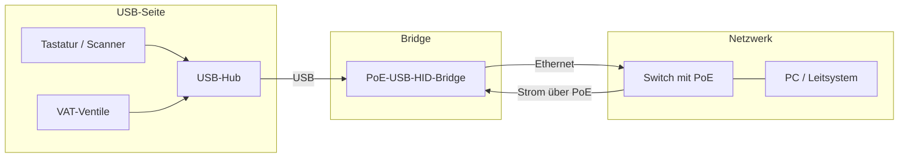
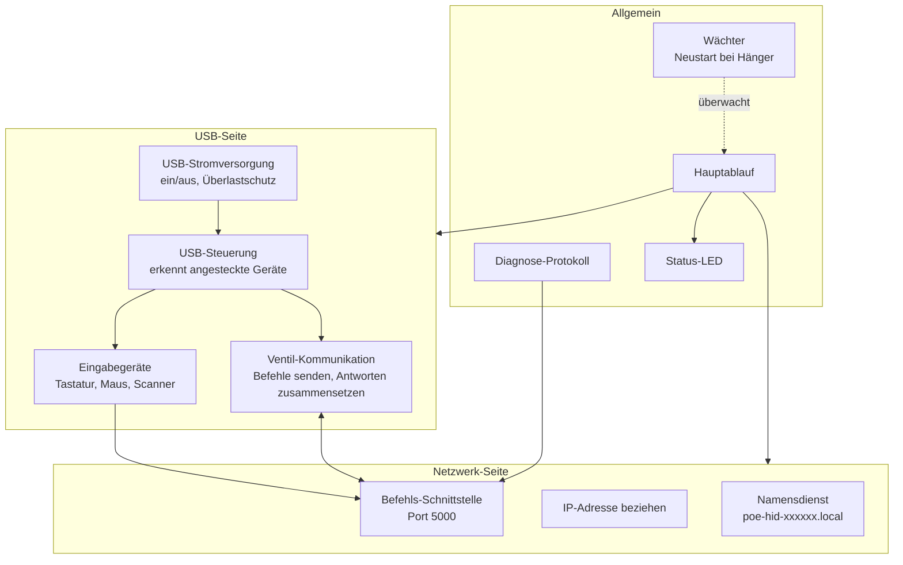
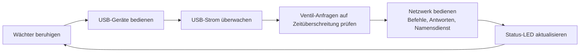
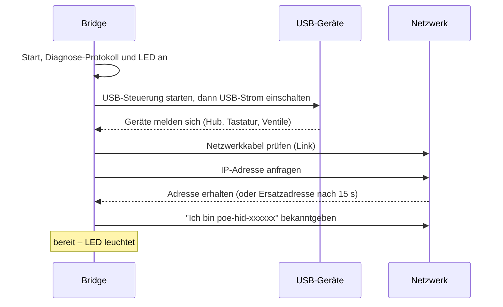
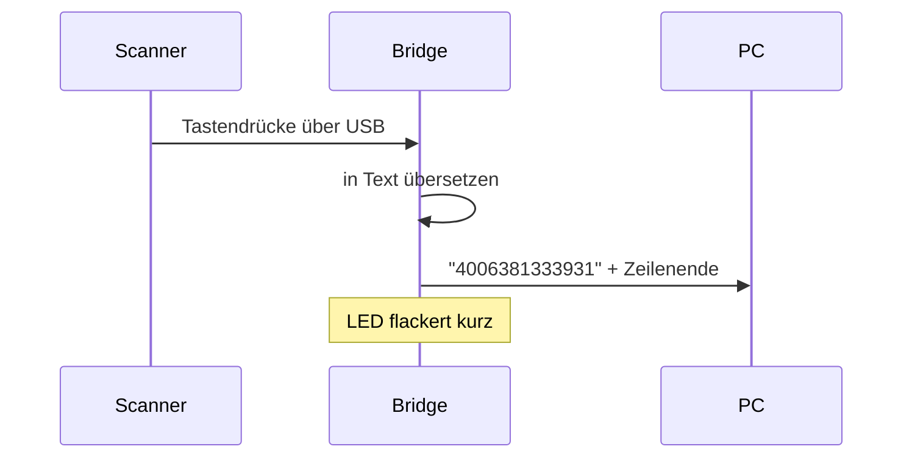
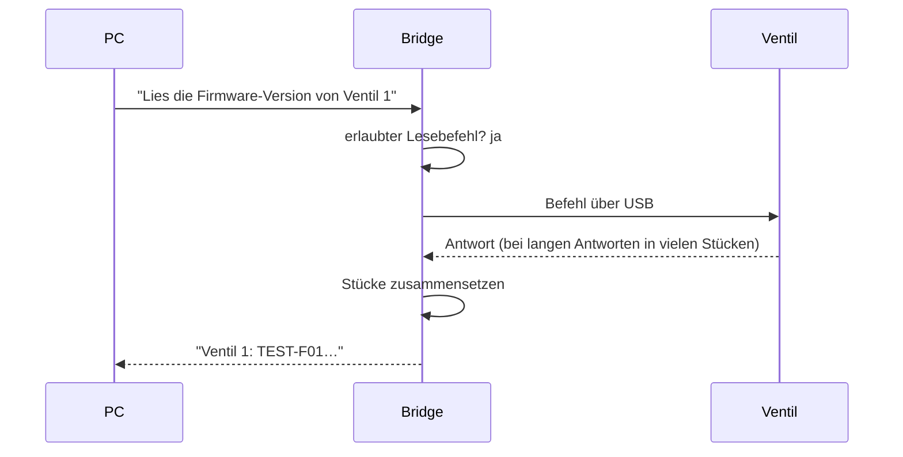
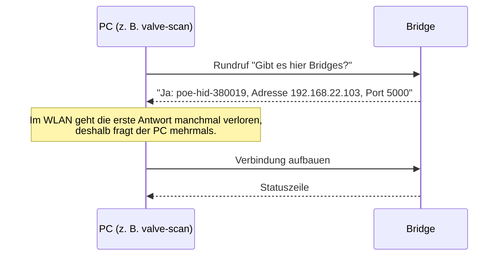
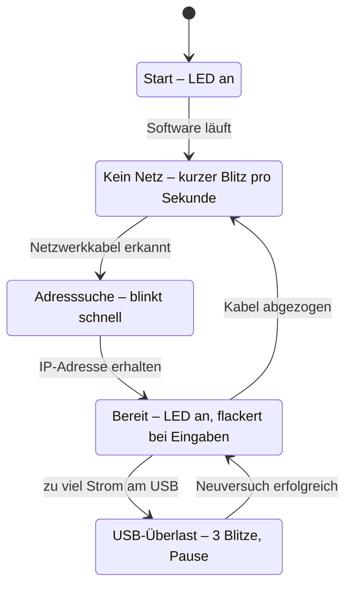
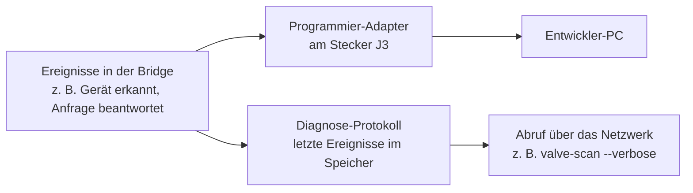

# Firmware-Architektur – PoE-USB-HID-Bridge

Diese Übersicht erklärt, wie die Software auf der Bridge aufgebaut ist und wie die Daten durch das Gerät fliessen.
Sie richtet sich an Leserinnen und Leser ohne tiefe Embedded-Kenntnisse.

## Was macht die Bridge?

Die Bridge verbindet USB-Geräte mit dem Netzwerk. Sie wird über das Netzwerkkabel mit Strom versorgt (PoE).

- **Tastaturen und Barcode-Scanner:** Was getippt oder gescannt wird, schickt die Bridge als Text ins Netzwerk.
- **VAT-Ventile:** Ein PC im Netzwerk kann Werte der Ventile lesen (z. B. Position, Firmware-Version, Fehler).
  Schreibende Befehle sind gesperrt.
- **Auffindbar im Netz:** Die Bridge meldet sich unter einem eigenen Namen (`poe-hid-xxxxxx.local`), so dass sie
  ohne Kenntnis der IP-Adresse gefunden wird.

## Die Bausteine

Die Software besteht aus wenigen, klar getrennten Teilen. Jeder Teil hat genau eine Aufgabe.

| Baustein | Aufgabe in einem Satz |
|---|---|
| Hauptablauf | Ruft alle anderen Bausteine reihum immer wieder auf, viele tausend Mal pro Sekunde. |
| USB-Steuerung | Erkennt, was am USB-Anschluss steckt (auch hinter einem Hub), und meldet es den zuständigen Bausteinen. |
| Eingabegeräte | Übersetzt Tastendrücke in Text und Mausbewegungen in kurze Meldungen. |
| Ventil-Kommunikation | Verpackt Lesebefehle für die Ventile, wartet auf die Antwort und setzt lange Antworten wieder zusammen. Blockiert schreibende Befehle. |
| USB-Stromversorgung | Schaltet den Strom am USB-Anschluss und schaltet ihn bei Überlast (Kurzschluss, zu grosser Verbraucher) ab. |
| Befehls-Schnittstelle | Nimmt Befehle eines PCs entgegen und schickt Antworten und Eingaben zurück. |
| IP-Adresse beziehen | Holt sich automatisch eine Adresse im Netz; klappt das nicht, gilt eine feste Ersatzadresse. |
| Namensdienst | Antwortet, wenn ein PC nach `poe-hid-xxxxxx.local` oder nach Bridges allgemein fragt. |
| Diagnose-Protokoll | Merkt sich die letzten Ereignisse, damit man bei Problemen nachsehen kann, was passiert ist. |
| Status-LED | Zeigt den Zustand an (Start, kein Netz, Adresssuche, bereit, USB-Überlast). |
| Wächter | Startet die Bridge automatisch neu, falls die Software einmal hängen sollte. |

## Der Hauptablauf

Die Bridge hat kein Betriebssystem. Ein einziger Ablauf erledigt alle Aufgaben nacheinander in einer endlosen Runde.
Jede Aufgabe ist kurz und wartet nie lange, dadurch reagiert die Bridge trotzdem sofort.

## Ablauf beim Einschalten

## Beispiel 1: Ein Barcode wird gescannt

Ist gerade kein PC verbunden, wird der Text verworfen.

## Beispiel 2: Ein PC liest einen Wert aus einem Ventil

Regeln dabei:

- **Nur lesen:** Befehle, die etwas am Ventil verändern würden, lehnt die Bridge ab, bevor sie das Ventil erreichen.
- **Eins nach dem anderen:** Es läuft immer nur eine Ventil-Anfrage gleichzeitig. Eine zweite muss warten.
- **Zeitlimit:** Antwortet das Ventil nicht innerhalb einer Sekunde, meldet die Bridge eine Zeitüberschreitung.

## Wie findet ein PC die Bridge?

## Zustände und Status-LED

## Schutzmechanismen

| Was kann passieren? | Was macht die Bridge? |
|---|---|
| Software hängt | Der Wächter startet die Bridge nach 3 Sekunden neu. |
| USB-Gerät zieht zu viel Strom oder hat einen Kurzschluss | Strom am USB-Anschluss wird abgeschaltet und später erneut versucht (erst nach 1 s, dann immer länger bis 32 s). |
| Ventil antwortet nicht | Nach 1 Sekunde Meldung „Zeitüberschreitung“, die Bridge arbeitet normal weiter. |
| Jemand schickt einen schreibenden Ventilbefehl | Wird abgelehnt und erreicht das Ventil nie. |
| Gerät mit virtuellem CD-Laufwerk (wie die Ventile) | Das Laufwerk wird ignoriert, nur die Datenschnittstelle des Ventils wird genutzt. |
| PC liest zu langsam oder ist nicht verbunden | Daten werden verworfen, die Bridge läuft weiter. |

## Diagnose

Bei Problemen gibt es zwei Wege, ins Innere zu schauen:

- **Über das Netzwerk:** Ohne Zusatzgerät, z. B. mit `valve-scan --verbose`. Zeigt die letzten Ereignisse seit dem Start
  und live alles, was während des Laufs passiert.
- **Über den Programmier-Adapter:** Für Entwickler, mit einem Raspberry Pi Pico als Adapter am Stecker J3. Damit wird
  auch neue Software aufgespielt.

## Grenzen

- Nur **ein** PC kann gleichzeitig mit der Bridge verbunden sein.
- Höchstens **2 Hubs** und **8 USB-Geräte**.
- Tastatur-Übersetzung nur für **US-Tastaturlayout** (Scanner entsprechend einstellen).
- Keine Anmeldung oder Verschlüsselung: Jeder im Netz kann sich verbinden. Die Ventile sind durch die Lese-Sperre geschützt.
- USB-Sticks werden nicht unterstützt.
