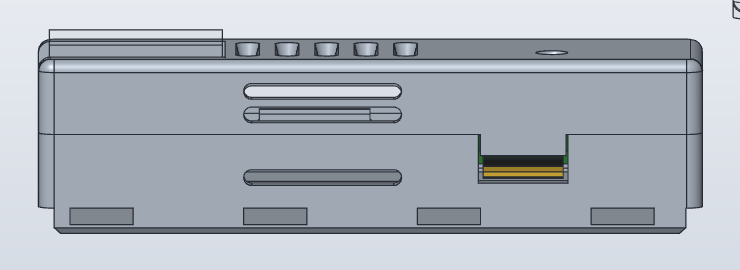
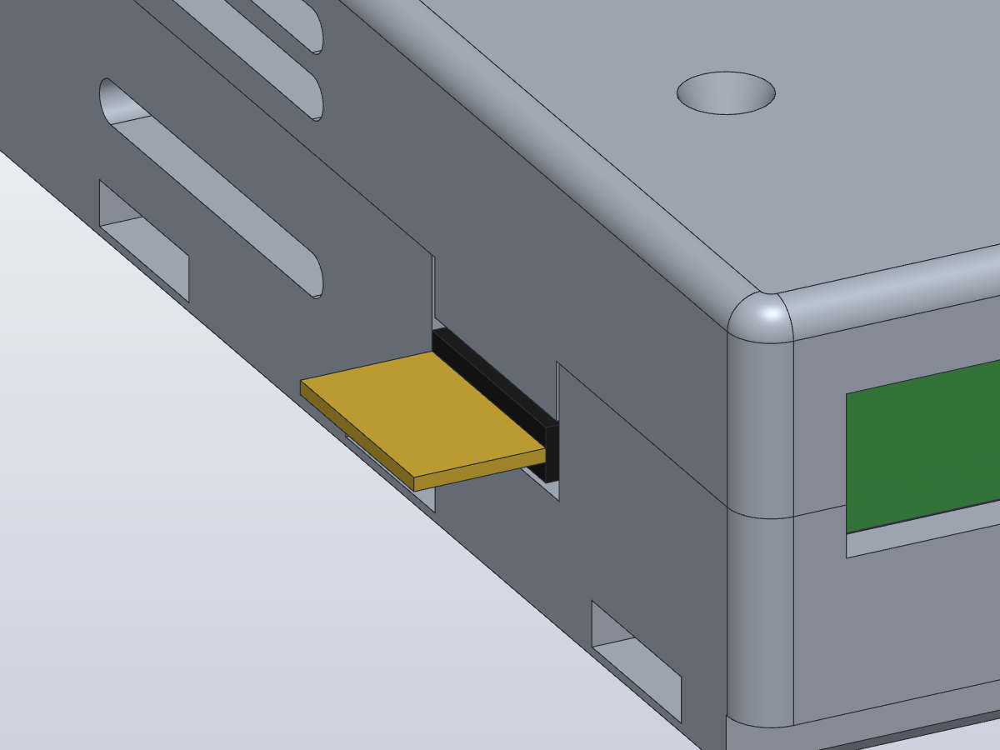

# Gehäuse eckig Rev 1 – Variante SWD (Stiftleiste J3 seitlich zugänglich)

Wie [`gehaeuse_eckig_rev1`](../gehaeuse_eckig_rev1/README.md), zusätzlich mit einer **seitlichen Aussparung für die
Debug-/Programmier-Stiftleiste J3**, damit der Programmer (Pico/debugprobe oder J-Link) bei geschlossenem Gehäuse
angesteckt werden kann.

Erzeugt aus demselben Skript mit der Option `--swd`:

```
python ../gehaeuse_eckig_rev1/make_script.py <dieser Ordner> script_swd.json --swd
solidcraft-cli run script_swd.json --save poe_usb_gehaeuse_eckig_swd.solidcraft
```




## Stiftleiste
1×4-Stiftleiste 2,54 mm **liegend auf die Randpads J3** (Platinen-Unterseite) löten, kurze Stiftenden auf den Pads,
Kunststoffkörper direkt an der Platinenkante, lange Stifte ragen ≈ 6 mm aus dem Gehäuse.
Belegung: **Pin 1 SWCLK auf der RJ45-Seite** (x 55,6), dann 2 GND, 3 SWDIO, **Pin 4 +3V3 auf der USB-Seite**
(x 63,2, nur Referenz, nicht verbinden). Pico: GP2 → 1, GND → 2, GP3 → 3.

## Unterschiede zur Standardvariante
| Teil | Änderung |
|---|---|
| Wanne | Aussparung in der −y-Längswand (Seite **ohne** Logo) bei x 53,7 … 65,1 (J3 bei x 59,4), von z −2,2 bis zur Trennfuge **nach oben offen** – die Platine wird mit aufgelöteter Stiftleiste von oben eingelegt. Die Auflageleiste ist dort unterbrochen. Spiel zum Stiftleistenkörper: 0,6 mm seitlich, 0,63 mm unten (Toleranz fürs Löten von Hand) |
| Deckel | **Zunge** schliesst die Aussparung von der Trennfuge bis z 1,3 (0,37 mm über dem Stiftleistenkörper), bündig mit der Aussenwand. 0,25 mm Spiel zu den Aussparungskanten: die Zunge führt den Deckel nicht (das tun die Eckanschläge), so klemmt nichts doppelt |
| Rastung | Hintere Rastlippe der −y-Seite von x 56–70 nach **x 66–76** verschoben (sonst läge ihre Rasttasche über der Aussparung); +y-Seite unverändert |

## Druck
Wie die Standardvariante (`A1_eckig_druckplatte.3mf`, PETG, keine Stützen): die Aussparung der Wanne ist nach oben
offen, die Zunge zeigt beim kopfüber gedruckten Deckel nach oben – kein Überhang.

## Prüfung
Interferenzprüfung Wanne/Deckel gegen alle Dummy-Körper (PCB, J1, J2, U1, J1-Pins, Unterseiten-Bauteile,
J3-Stifte innen, J3-Körper, J3-Stifte aussen): **0 Kollisionen** mit dem Gehäuse, alle 11 Körper geprüft.

## Offen
- Masse des tatsächlich verwendeten Stiftleisten-Typs prüfen (Körper 2,5 × 2,5 mm angenommen).
- Rastkraft der verschobenen −y-Lippe nach dem Druck prüfen.
